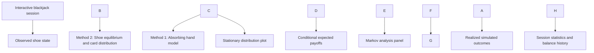

# A Markov Chain Analysis of Blackjack Strategy

**STATS 400 | Fall 2026 | Final Project**

### Group members

* Anthony Mitine
* Tommy Ngo
* Elan Hashem
* Camden White


An interactive, play-money blackjack simulator built in **R and Shiny** to demonstrate the probability models introduced in *A Markov Chain Analysis of Blackjack Strategy* by Michael B. Wakin and Christopher J. Rozell (2004). This project adapts their original MATLAB Blackjack Markov Chain Toolbox into a single R script, combining playable blackjack with visual explanations of absorbing Markov chains, stationary distributions, and expected value.

**Educational use only:** All balances and wagers are simulated credits. No real money, accounts, deposits, or payouts are involved. Model estimates are not guarantees of winnings or financial advice.

## Table of contents

* [Project motivation](#project-motivation)
* [Features](#features)
* [Getting started](#getting-started)
* [How to play](#how-to-play)
* [Mathematical methodology](#mathematical-methodology)
* [Understanding the Markov hint panel](#understanding-the-markov-hint-panel)
* [Results and discussion](#results-and-discussion)
* [Repository structure](#repository-structure)
* [Testing and limitations](#testing-and-limitations)
* [Contributing](#contributing)
* [License and acknowledgments](#license-and-acknowledgments)

## Project motivation

Our STATS 400 final project explores how probability models can be applied to a real-world stochastic system. The original paper asks whether the expected performance of blackjack strategies can be analyzed using Markov chains rather than relying entirely on simulated games.

We extend the accompanying toolbox into an interactive educational demonstration. The objective is to help students connect the theoretical models studied in class to observable outcomes, explore the effect of changing model parameters, and understand the distinction between long-run expectations and individual random events.

The project supports the course's 5–10 minute presentation and 2–4 page summary and reflection. The simulator is a supplementary demonstration, not a replacement for the article analysis.

## Features

|Feature|Description|
|-|-|
|Deck selection|2–6 standard 52-card decks|
|Player selection|Single player or 2–4 local players sharing one shoe|
|Starting balance|20–500 simulated credits per player|
|Interactive controls|Start, pause/resume, end session, and deal next round|
|Blackjack actions|Hit, stand, double down, split, and optional insurance|
|Markov analysis|Conditional expected outcomes and shoe-equilibrium information|
|Card rendering|Red and black suits, number-card pips, court-card illustrations, and concealed dealer card|
|Probability visualization|Theoretical stationary High-Low Index (HLI) distribution|
|Session statistics|Player balances, settled profit/loss, wins, losses, pushes, and balance history|
|Lightweight setup|One R script, one additional R package, no external card assets or databases|

Multiplayer is local and turn-based: all players take turns on the same computer. Online multiplayer is not currently implemented.

## Getting started

### Prerequisites

* [R](https://cran.r-project.org/) installed on your computer.
* [RStudio Desktop](https://posit.co/download/rstudio-desktop/) (optional but recommended).
* A modern web browser.

MATLAB is not required.

### 1\. Download the repository

On GitHub, select **Code → Download ZIP**, extract the archive, and locate `Blackjack\_MC\_Shiny.R`. Alternatively, copy the repository URL from the **Code** menu and clone it with Git.

### 2\. Install the dependency

Open the R or RStudio console and run:

```r
install.packages("shiny")
```

This installation is only required once per R environment.

### 3\. Launch the application

Open `Blackjack\_MC\_Shiny.R` in RStudio and click **Source**, or set your working directory to the repository folder and run:

```r
source("Blackjack\_MC\_Shiny.R")
```

You can also launch it from a terminal in the repository folder:

```bash
Rscript Blackjack\_MC\_Shiny.R
```

The application launches in a local browser window. Keep the R process running while playing. To close the server, stop the running R process (RStudio's Stop button or `Ctrl+C` in the terminal).

### Troubleshooting

* If R reports that `shiny` is missing, run the installation command above.
* If R cannot find the script, check your current folder with `getwd()` and open the correct repository folder.
* If the browser does not open automatically, use the local URL printed in the R console.
* If you encounter an error, open a GitHub issue with the error message, R version, operating system, and steps to reproduce it.

## How to play

1. Choose the number of decks, players, and starting credits in **Session settings**.
2. Click **Start** to initialize the session and the shoe-equilibrium model.
3. Enter each player's simulated wager and select **Deal next round**.
4. Take turns playing the highlighted hand. Available controls depend on the game state and remaining credits.
5. Use **Markov hint** to inspect the statistical model before a deal, during a hand, or during an insurance decision.
6. After all players finish, the dealer completes its hand and the application settles the round automatically.
7. Review the results and probability plots. Select **Deal next round** to continue, **Pause / Resume** to suspend play, or **End session** to finish. Ending an unfinished round cancels it and refunds its stakes.

### Controls

|Control|Function|
|-|-|
|Hit|Draw another card|
|Stand|Finish the active hand|
|Double|Double the initial hand stake, draw one card, and finish the hand|
|Split|Separate a pair into two hands, with an additional equal stake|
|Take / Pass insurance|Accept or decline insurance when the dealer shows an ace|
|Markov hint|Display model-based analysis for the current decision stage|

### Rules implemented

The dealer stands on all totals of 17 or higher, including soft 17. A natural blackjack pays 3:2; ordinary wins pay 1:1; ties return the stake. Doubling is allowed on two cards, including after a split where applicable. Each player may split once per round, and split aces receive one additional card each. Insurance pays 2:1. Surrender is not supported. Players with insufficient credits for a minimum one-credit stake sit out.

## Mathematical methodology

The simulator uses two discrete-time Markov chain models adapted from Sections 3 and 4 of the paper. It also includes randomized gameplay so users can compare observed outcomes with analytical expectations.

### Method 1: Absorbing Markov chains for individual hands

A hand is represented by states containing its total, ace status, and other relevant characteristics. Terminal states correspond to completed hands, including busts and blackjacks.

For a transition matrix $P$,

$$
P\_{ij}=\\Pr(X\_{t+1}=j\\mid X\_t=i).
$$

The MATLAB implementation evaluates absorption using matrix powers. The R adaptation instead uses recursive expected-payoff calculations with memoization under a fixed card distribution and continuation policy:

$$
V(s)=\\sum\_{s'}P\_{ss'}V(s').
$$

Terminal values are determined by the modeled payoff rules. The expectation is expressed in net credits per unit of initial stake, rather than simply the probability of a win.

Relevant functions: `dealer\_end()`, `hand\_model()`, and the model's `predeal()` method.

### Method 2: Shoe evolution and stationary distributions

The shoe model groups previously observed cards into low, medium, and high categories and represents the state as $(L,M,H)$. As cards are removed, the category counts change; reshuffling returns the shoe to its initial state.

The long-run state distribution satisfies the stationary balance equation:

$$
\\pi=\\pi P,\\qquad \\sum\_s\\pi(s)=1.
$$

To avoid constructing an enormous transition matrix, the model aggregates states by the number of cards already dealt. The R implementation reconstructs the full state probabilities using the reduced chain and a multivariate hypergeometric distribution. This permits theoretical equilibrium calculations for the selectable deck counts without building a dense matrix of all possible shoe transitions.

Relevant functions: `shoe\_equilibrium()`, `shoe\_state()`, and `hli\_equilibrium()`.

### How the two models fit together



The shoe model supplies the grouped card distribution used by the hand model and describes the long-run frequency of shoe states. The hand model calculates conditional expected payoffs. Equilibrium probabilities contextualize these calculations; they are not a separate independent prediction of a hand's outcome.

**Markov chains versus MCMC:** This is an application of discrete-time Markov chains. Randomized gameplay is simulation, but the analytical model is not a Markov Chain Monte Carlo sampling algorithm.

## Understanding the Markov hint panel

The panel is an educational interface for comparing theoretical and observed outcomes. Its content changes depending on whether the round has begun, a player is acting, or insurance is being considered.

It reports conditional expected values, information from the historical strategy implemented in the toolbox, grouped shoe counts, HLI, and stationary state probabilities. The action comparisons assume the paper's fixed-distribution model and its continuation policy; they are not a proof of globally optimal play. The historical simulated wager display is not an optimization of bankroll risk.

The shoe-equilibrium chart describes the theoretical long-run distribution of HLI for the selected number of decks. The session results chart, in contrast, describes the actual outcomes of the current simulated session. These are different statistical objects and should not be interpreted as interchangeable.

## Results and discussion

The original article demonstrates that its two Markov models can be combined to evaluate the expected gain of a prescribed strategy. Its main computational insight is that the large shoe state space can be reduced using the shared transition structure of states with the same number of cards dealt.

In the R adaptation, students can examine:

* How the stationary HLI distribution changes with the number of decks.
* How theoretical conditional expected values differ from outcomes of particular hands.
* How realized session balances vary across repeated simulations, even with identical starting settings.
* How simplifying assumptions affect the interpretation of a model.

These demonstrations connect to STATS 400 topics including conditional probability, discrete-time Markov chains, transition matrices, absorbing states, equilibrium distributions, convergence, and the law of total expectation.

The app is not a full replication of every numerical result or figure in the original paper. A short session is not enough to validate a long-run expected-value calculation.

## Repository structure

The minimum repository contains:

```text
A\_Markov\_Chain\_Analysis\_of\_Blackjack\_Strategy\_STATS400\_Final/
├── Blackjack\_MC\_Shiny.R   # Mathematical models, game engine, UI, and self-tests
└── README.md               # Project documentation
```

The R script is intentionally self-contained. It contains the original strategy tables, shoe-equilibrium functions, hand-model functions, physical shoe simulation, inline HTML/CSS card rendering, and Shiny session controller.

### Relationship to the original MATLAB toolbox

|Original toolbox component|R adaptation|
|-|-|
|`setupVariables.m`, `setStrategy.m`|Embedded strategy tables and `make\_policy()`|
|`calcDealerTrans.m`, `calcPlayerTrans.m`|Recursive dealer and player calculations|
|`calcPlayerTransSplit.m`, `computeTermProfit.m`|Split-hand and terminal payoff calculations|
|`advSingleHand.m`, `advInsurance.m`|Expected-payoff analysis|
|`equilib.m`, `reshuffle.m`, `lmh2deckPdf.m`|Shoe state and stationary distribution calculations|
|`BJMCmainScript.m`|Interactive R/Shiny application and session controller|

The adaptation replaces dense matrix calculations with recursive or closed-form equivalents where appropriate and adds a finite-shoe game engine, browser interface, multiplayer support, and visualizations.

## Testing and limitations

### Run the included model self-tests

From a terminal in the repository folder:

```bash
Rscript Blackjack\_MC\_Shiny.R --self-test
```

The checks cover hand totals and ace handling, shoe balance equations for 2–6 decks, card counts, normalization of probability distributions, dealer terminal outcomes, and selected expected-value regression cases. This mode runs without launching Shiny.

**Development status:** The initial R port has been statically reviewed and its core mathematical logic cross-checked independently. End-to-end execution in R/Shiny has not yet been verified. The self-test command and browser gameplay should be checked locally before treating the app as fully tested.

### Model assumptions and limitations

* The analytical hand model freezes card probabilities and strategy at the beginning of a round. Actual gameplay samples from a finite shoe without replacement.
* Grouping cards into three categories loses exact rank-composition information.
* The theoretical shoe model operates at card-level transitions. Gameplay reshuffles between rounds and reserves cards for multiplayer, so its empirical distribution need not exactly match the theoretical stationary distribution.
* The analytical model uses specified blackjack rules and approximates shared-shoe dependencies rather than fully modeling multiplayer interactions.
* Expected value does not establish the probability of making a profit over a session, nor does it measure the full distribution of financial risk.
* The application does not reproduce the paper's complete strategy-wide expected-gain analysis across every possible shoe state.

## Contributing

Contributions from classmates and other interested developers are welcome, particularly improvements that make the app more accurate, accessible, and useful for teaching probability.

### Suggested contributions

* Test the application on Windows, macOS, and Linux and report reproducible bugs.
* Add regression tests for card rendering, game settlement, splitting, insurance, and pause/resume behavior.
* Compare analytical probabilities with independent simulated outcomes in a reproducible experiment.
* Improve plot labels, accessibility, mobile layout, and explanations of statistical assumptions.
* Add reproducible examples or educational exercises for STATS 400 concepts.
* Document differences between the R adaptation and the original MATLAB implementation.

### How to submit a contribution

1. Fork the repository using GitHub's **Fork** button.
2. Clone your fork and create a new branch:

```bash
   git checkout -b feature/my-improvement
   ```

3. Make your changes, keeping the application in a single R script where practical.
4. Run the self-tests and manually check the affected gameplay or visualizations.
5. Commit and push your changes:

```bash
   git add Blackjack\_MC\_Shiny.R README.md
   git commit -m "Describe the improvement"
   git push -u origin feature/my-improvement
   ```

6. Open a pull request explaining what changed, why it changed, how it was tested, and any remaining limitations.

Please retain the original authors' attribution and license notice in all derivative code. Keep the project educational and play-money only. Do not include real-money gambling integrations or personal data in contributions.

## License and acknowledgments

This repository is a 2026 R/Shiny adaptation of the **Blackjack Markov Chain Toolbox, Version 1.0 (January 8, 2009)**. The original toolbox is copyright 2009 Michael B. Wakin and Christopher J. Rozell and is distributed under the [Creative Commons Attribution 3.0 Unported license (CC BY 3.0)](https://creativecommons.org/licenses/by/3.0/). The original attribution and license header are retained in `Blackjack\_MC\_Shiny.R`. Reuse of the adapted toolbox material must preserve attribution, identify modifications, and communicate the applicable license terms. No separate license for newly authored project material has been designated here.

### Original paper

Wakin, M. B., \& Rozell, C. J. (2004). *A Markov Chain Analysis of Blackjack Strategy*. Department of Electrical and Computer Engineering, Rice University.

* [Rice University repository record](https://repository.rice.edu/items/1abebb50-9696-465c-8ed5-7c4a6f33c890)
* [Original manuscript (PDF)](https://repository.rice.edu/server/api/core/bitstreams/3408f6c5-c0f3-4b20-bd4e-b9d10d9809b6/content)
* [Author's publications page and original MATLAB toolbox](https://people.mines.edu/mwakin/publications/)

### Credits

We thank **Michael B. Wakin** and **Christopher J. Rozell** for developing the original mathematical framework and making the companion MATLAB toolbox available. Their work forms the foundation of this project. We also acknowledge Harvey Dubner and Edward O. Thorp for the historical Complete Point-Count System examined in the original research.

The STATS 400 project group is responsible for this educational R/Shiny adaptation, interactive interface, and accompanying project analysis. This project is not an official release of, or endorsed by, the original authors.

